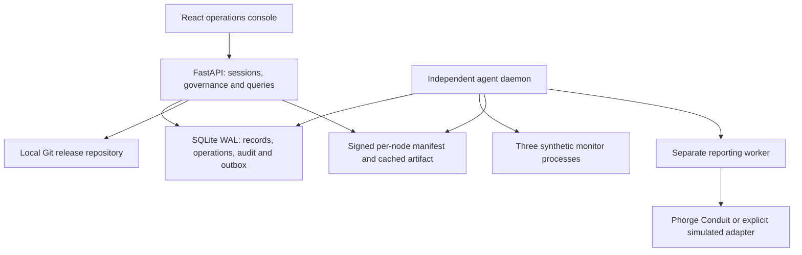

# Delivered architecture

The original REVIEW-01 plan used a ten-second Python scanner, an overwrite script and a Phabricator incident bridge. The delivered system retains that SCM objective and adds explicit assignment, authorization, verification and evidence.

## Runtime topology

`run.sh` starts an independent daemon and disables the API's embedded supervisor. The two processes share a local runtime directory. Reentrant file locks serialize node operations and reporting across processes; a separate file lock serializes Git release creation. SQLite uses WAL, FULL synchronous mode and short write transactions. Network calls do not run inside the detector loop or a database write transaction.

The convenient standalone Uvicorn command embeds the supervisor. That mode stops monitoring when the API stops. The recommended independent-daemon launch is the mode that supports recovery while the API is unavailable.

## Configuration lifecycle

Bootstrap fixtures are explicitly identified as demonstration fixtures. A release record contains exact Git commit/path, byte digest, semantic digest, profile, configuration and approval evidence. Node assignments include a generation and release ID; a new Git HEAD has no deployment effect.

The per-node recovery manifest binds node, release, profile, byte digest, generation and expiry using HMAC with a locally generated private key. Automatic recovery reads a cached artifact and validates both signature and content. This local trust model assumes an uncompromised host; it is not hardware-backed attestation.

## Drift and recovery

1. The agent performs a stable, bounded, no-follow file read and compares the assigned digest.
2. It distinguishes parameter changes, formatting-only changes, malformed/missing files and effective-state mismatches.
3. It writes original evidence and a persistent incident before any replacement.
4. It checks manifest scope, expiry, digest, profile, connectivity and assignment generation under a process lock.
5. It records recovery intent, writes a same-filesystem temporary file, flushes, replaces atomically and reads back the installed digest.
6. The independent monitor must load that digest successfully. A failed reload never becomes a successful recovery.
7. A failed attempt has one bounded retry. The failed condition remains latched rather than producing a retry every scan. Repeated drift episodes open a circuit breaker after three recent episodes; a fourth triggers intervention.
8. The resulting incident enters a durable reporting queue. Acknowledgement and CCB closure are separate from recovery.

File replacement is atomic; the complete file/process/database operation is not. A persistent operation journal and startup reconciliation handle interrupted operations. Recovery uses the persisted node assignment. An interrupted deployment reconstructs its persisted assignment from the exact Git object before repairing manifest/file state.

An authorized demonstration reset clears the recent-episode window and restores the current assigned fixture; it does not delete incidents or audit history.

## Change control

The proposal digest is immutable. Submitter, technical reviewer and CCB approver are three different accounts. A stale digest or node generation blocks the operation. An approved scoped deployment expires after one hour.

The deployment holds the same node lock as recovery. The new assignment is committed only after disk and effective-state verification. A failure attempts the previously trusted configuration only when replacement actually began, and records whether that recovery was verified. Multi-node deployment reports per-node outcomes; there is no fleet-wide atomic transaction.

In real Phorge mode the accepted Differential raw patch is applied in an isolated temporary directory to the recorded base artifact; its resulting bytes must match the proposal digest. The accepted diff PHID is checked again before deployment. This integration code has not been validated against a user-supplied live instance.

## Persistence and migration

The implementation deliberately uses standard-library SQLite rather than adding SQLAlchemy/Alembic for a three-node demo. Logical entities are JSON records keyed by `(kind, id)`; audit events have a separate indexed sequence/hash table. This simplifies setup at the cost of fewer database-level foreign-key constraints. Domain validation, immutable release conventions and transactions enforce the workflow.

Logical kinds: users, sessions, nodes, releases, changes, approvals, incidents, operations, settings and outbox. Database schema version 1 is recorded in `schema_versions`; migration changes must be added as ordered transactional migrations before changing an existing database schema. There are no remote-agent credential endpoints in this single-host build.

Original evidence is stored in private per-node evidence files; diffs, digests, outcomes, approvals and operations are included in authenticated JSON exports. CSV export contains audit rows and neutralizes spreadsheet formula prefixes. Runtime databases, credentials, evidence, cached artifacts and mutated files are excluded from Git.

## Reporting semantics

The simulated adapter emits `SIM-…` identifiers with no external link. Real reporting uses Conduit task search/edit, configured project/owner and configured critical priority. Formatting-only incidents use low priority. The actual installed values must be verified during integration setup.

Creation intent is marked uncertain before an external creation call. If its response is lost, the worker searches for the exact incident marker before doing anything else. If absence is uncertain it holds the report rather than blindly creating another task. A manually reconciled task with the exact marker can be discovered on a later attempt. There is no claim of exactly-once behavior across an arbitrary external service.

Herald configuration is a separate installation step. The repository contains a rule specification and validation procedure, not a JSON file falsely presented as an installed rule.

## Access and UI

Passwords use scrypt with unique salts. Random session tokens are stored hashed; cookies are HttpOnly/SameSite Strict, with an optional Secure flag. Every mutation except sign-in requires a session-bound CSRF token. Backend role checks enforce permission independently of button visibility. Failed sign-ins are bounded by an IP-based rate limiter.

The GUI reflects actual API records and last-refresh time. Offline nodes show current state unknown. A direct file mismatch can show awaiting scan until the enforcement agent records it. Historical incident observations remain labelled as historical even after successful recovery. The console uses bundled fonts and local assets rather than external runtime CDNs.

## Limits

The host and private runtime directory remain the trust boundary. Locks coordinate managed writers; a malicious root process can bypass controls. The audit chain is tamper evidence within that boundary, not immutable storage. Simulator health means the synthetic configuration was loaded; it does not measure medical safety. Real device adapters, clinical validation, distributed replication, HA storage and external identity providers are outside this academic implementation.
